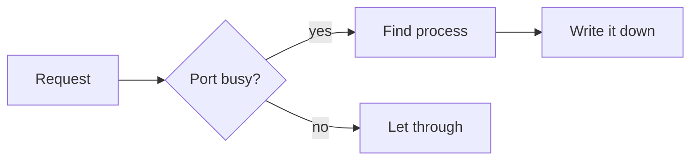
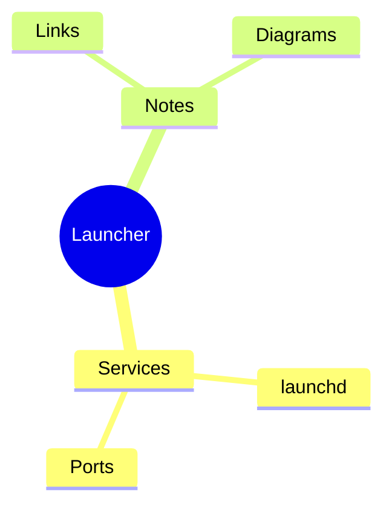
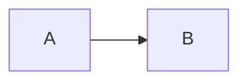

# Notes feature tour

This note was generated by the app and demonstrates every construct the editor understands.
**Change it or delete it freely** — it is only created once, when your notes folder is
**completely empty**, and never comes back.

## 1. Basic formatting

**Bold**, *italic*, ***bold italic***, ~~strikethrough~~, `inline code`, and [links](https://example.com).
Links open in your **system browser**, not inside the app.

A URL in angle brackets becomes a link too: <https://example.com>. **A bare URL stays text** —
so mentioning one in passing does not silently turn into a link.

`_italic_` and `__bold__` work as well, equivalent to the asterisk forms (this note uses asterisks
throughout). But underscores next to a letter or digit do not count — `foo_bar_baz` stays literal,
so variable names are not chopped into italics.

Backslashes escape: \*this is not italic\*.

**Sub / superscript**: `H~2~O` renders as H~2~O, `x^2^` renders as x^2^.

**Paragraph alignment**: wrap the lines in `<div align="center">` (the one form both GitHub
and Obsidian understand). The toolbar has left / centre / right buttons — select a few lines
and click. **Left is "remove alignment"**, since that is Markdown's default:

<div align="center">

This paragraph is centred

</div>

<div align="right">

This one is right-aligned

</div>

> Markdown has **no standard syntax** for paragraph alignment; HTML's `align` is the only
> portable one. That makes this the one piece of HTML the app understands (the other is
> `<br>` inside table cells) — every other tag is shown as plain text.


> A plain quote is just a line starting with `>`. It is not the same thing as the callouts below.
>
> A quote takes **block content** too — like a callout, its body is rendered block by block:
>
> - A
> - B
>
> > A nested quote looks like this
>
> ```bash
> lsof -i :8080
> ```
>
> | Port | Process |
> |---|---|
> | 8080 | node |

(A table **inside a quote or callout behaves exactly like one in the body** — resizing columns and
rows, double-clicking a cell, adding rows and columns all work. The fence and every re-laid-out line
carry the `> ` prefix, so nothing escapes the quote. Diagrams, images and embeds are the same.)

All six heading levels work. This note only uses `#` and `##`; the four lines below are
what `###` down to `######` look like:

### Heading 3

#### Heading 4

##### Heading 5

###### Heading 6

---

## 2. Callouts

Write `> [!TYPE]` and the quote renders as a card with an icon and its own colour. Five types:

> [!NOTE]
> Additional context. Blue.

> [!TIP]
> A small trick. Green.

> [!IMPORTANT] The title can be customised
> Whatever follows the marker becomes the title. Purple.

> [!WARNING]
> Something to watch out for. Amber.

> [!CAUTION]
> An operation that can cost you data. Red.

**A card body takes block content too** — exactly like a plain quote:

> [!TIP] The body can hold lists, code blocks, images
> The order to check a busy port in:
>
> 1. See what is holding it
> 2. Then decide whether to kill it
>
> ```bash
> lsof -i :8080
> ```

**Typing `> [` in the editor pops up these five**, Enter inserts the skeleton.

## 3. Collapsible blocks

`<details>` folds away until you click the title — understood by GitHub and Obsidian alike:

<details>
<summary>Click to expand (it can hold anything)</summary>

Markdown inside a details block works as usual — lists, code blocks, tables:

- A
- B

```bash
lsof -i :8080
```

| Port | Process |
|---|---|
| 8080 | node |

</details>

<details open>
<summary>This one starts expanded</summary>

Write `<details open>` in the source and it starts open.

</details>

## 4. Lists and tasks

- Bullet list
  - Nested
    - One level deeper
- Mixed is fine

1. Ordered list
2. Second item

- [ ] A todo
- [x] A finished one

Check them straight from the preview; ⌘Z undoes it.

## 5. Tables

| Port | Process | State |
|:--|:-:|--:|
| 8080 | node | busy |
| 6379 | redis | free |

Alignment uses `:--` (left), `:-:` (centre), `--:` (right). The toolbar's table button inserts one by
dragging out rows and columns.

**Double-click any cell in the preview to edit it** — the whole block is re-laid out and the source
follows. Under the table there are **add row / add column**, and each row and column has a delete
button on its right.

The default border style lives under **Settings › Notes › Table style**; a single table can override it:

```table border=none
| Borderless | Still readable via alignment |
|---|---|
| A | B |
```

```table border=thick color=#8b5cf6
| Thick | Purple |
|---|---|
| A | B |
```

Width goes in the fence too (without it the table fills the column). **Dragging the table's
bottom-right corner changes it as well**, and writes the number back here on release:

```table width=320
| Fixed at 320 | Second column |
|---|---|
| A | B |
```

**A cell can hold block content too** — one line of source, with `<br>` as the line separator
(write a literal pipe as `\|`, otherwise it splits the column):

| Kind | Content |
|---|---|
| List | - A<br>- B |
| Code block | ```bash<br>lsof -i :8080<br>``` |
| Diagram | ```mermaid<br>flowchart LR<br>A --> B<br>``` |
| Nested table | \| a \| b \|<br>\|---\|---\|<br>\| 1 \| 2 \| |
| Image |  |
| Video / audio / PDF |  |

With nothing but `<br>` line breaks and no block syntax, a cell stays one paragraph on two lines —
`first<br>second` does not split into two paragraphs. Task lists, tables and diagrams inside a cell
are **read-only**: they all come from that one line of source, and writing back by line number would
corrupt the whole table row. Images / video / PDF / diagrams inside a cell **scale with the cell** —
widen the column and they widen too. **A table inside a cell** works the same way once the outer
table's columns are pinned (`cols=`); without pinned columns it shrinks to its own content, because
following the cell would be a circular dependency (table width needs the cell width, which needs the
table width).

⚠ **That inner table cannot be resized on its own** — there is nowhere to store the numbers: a cell
is a single line of source, and column widths can only live in a ````table fence, which means
inserting lines.

So no handles ever appear on it, and the outer table's column lines are **broken around it** (a line
crossing it would look like the inner table's, while dragging it would resize the outer one). To
change it, resize the **outer** table's columns and it follows.

**Column widths and row heights** go in the fence as well: `cols=200,100,auto` (`auto` = size to
content) and `rows=80,40` (**minimum** heights, row 1 is the header). Omit them and nothing changes.

In the preview you can also **drag a column or row boundary**; the number is written back on release,
and a click that does not move anything writes nothing. A column boundary can be grabbed **anywhere
along its height** (no need to go back up to the header) and a row boundary **anywhere along its
width**.

Move the pointer onto a boundary and the cursor becomes **↔** (a vertical column line — drag left /
right) or **↕** (a horizontal row line — drag up / down); anything within 8px of the line counts, so
there is no need to aim at that 1px line. Dragging a column carries the table width with it, so the
neighbouring columns stay put.

### Layout tables: using a table as a grid

Add `layout` and it stops being a data table — **no borders, and the first row is no longer a
header** (no background, no bold, no nowrap). This is what "image left, text right" needs: GFM
requires a separator row, so the content can only live in the first row, and that row renders as a
header by default.

```table layout cols=120,auto rows=120
|  | **Port check**<br>See what is holding 8080, then decide.<br>The image scales with this column. |
|---|---|
```

`layout` combines with `cols=` / `rows=` / `width=`, and the cells still take lists, code blocks,
diagrams and nested tables.

## 6. Code

```bash
# Name the language inside the fence and you get syntax highlighting
lsof -i :8080
```

```json
{ "port": 8080, "name": "node", "pid": 1234 }
```

```yaml
label: homebrew.mxcl.redis
program: /opt/homebrew/bin/redis-server
keepAlive: true
```

Common languages are covered: js / ts / json / html / css / xml / plist / yaml / toml / ini / sh /
py / sql / go / rust / dockerfile / diff / nginx … **Hover a code block and a copy button appears
in its top-right corner.**

A fence can use tildes (`~~~`) as well. That saves counting backticks when the content already
contains three of them:

~~~text
the ``` inside this line does not close the fence
~~~

If you would rather stay on backticks, **wrap three of them in four** — the closing fence has to be
at least as long as the opening one, so the inner three do not end it.

## 7. Images and media

Images, video, audio and PDF all use the same syntax — the extension picks the control.
These are **live examples** (the sample files ship with this note in `assets/`).

**① No size given: fill the column** (an image stops at its natural size; video/audio/PDF always fill)


**② Fixed width** `` — for images, video and audio (height follows the ratio)


**③ Fixed height** `` — for a PDF, whose width is always the full column


**④ Video and audio** (full width by default, and draggable too)


**⑤ Drag to resize — try this one**

**Click any media block above** and a round handle appears in its bottom-right corner.
**Drag that handle**: the size follows live, and **on release the number is written back into the
source** (watch `` turn into `` in the editor on the left).

- Images / video / audio drag **width**; height follows the aspect ratio;
- A PDF or a page embed drags **height** (their width is always the full column);
- To undo, just delete the size — or drag it back.

Supported: images `png` `jpg` `jpeg` `gif` `webp` `avif` `bmp`; video `mp4` `webm` `mov` `m4v` `ogv`;
audio `mp3` `m4a` `wav` `ogg` `flac` `aac`; documents `pdf`.

Supported: images `png` `jpg` `jpeg` `gif` `webp` `avif` `bmp`; video `mp4` `webm` `mov` `m4v` `ogv`;
audio `mp3` `m4a` `wav` `ogg` `flac` `aac`; documents `pdf`.

**Size** goes inside the brackets (Obsidian's syntax):

```markdown
       width 300
   both
           height only
```

**Click a media block in the preview and a handle appears in its bottom-right corner — drag it to
resize**, and the syntax above is rewritten on release.

Paste or drop a screenshot straight into the editor; it lands in the notes folder's `assets/`.
**Remote image URLs (`https://…`) are displayed too.**

An image that fails to load degrades to a small grey strip showing its address rather than a broken
icon — hotlink-blocking image hosts (Bilibili, Zhihu) are common, and that is not your syntax.

## 8. Page embeds

A local page (**no network request at all**):

```embed
assets/sample-page.html
width: 260
height: 220
```

A URL (the preview **fetches that page over the network**):

```embed
https://example.com
height: 240
```

The **↗** next to the address opens it in your system browser. Besides `height:` the fence also
takes `width:`, or you can drag the bottom-right corner to resize. A remote address only renders if
the site allows being framed — plenty refuse, and that is not the app's doing.

## 9. Diagrams





The rightmost toolbar button inserts a diagram with visual direction and theme controls; hovering a
rendered diagram reveals copy-source and edit. A `width=360` in the fence fixes its width (without
one it uses the diagram's own size, up to the column width), or drag the bottom-right corner.

**A syntax error does not vanish silently** — that spot shows Mermaid's error message next to your
source, so you can fix it in place.

## 10. Scenario matrix: the same thing in every kind of box

**Every cell below is meant to be tried right here** — resize columns and rows, double-click a
cell, tick a task, drag a diagram's or an image's handle — then look at the source on the left:
**you can see at a glance whether the write-back landed in the right place.**

All eight kinds of box are here: body, quote, nested quote, callout, collapsible block (three
spellings) and aligned block. They differ only in **how the line number is computed** and **what
prefix is carried**, so every cell holds the same four things: a **table** (resize, edit a cell),
a **task** (tick it), a **diagram** (resize, edit) and an **image** (drag its handle).

(Diagrams are two nodes and images are 40px — this section is a **checklist**, not a showcase;
the smaller it is, the faster it scans.)

### 1. Body

| 甲 | 乙 |
|---|---|
| 1 | 2 |

- [ ] a task in the body




### 2. Quote

> | 甲 | 乙 |
> |---|---|
> | 1 | 2 |
>
> - [ ] a task in the quote
>
> ```mermaid
> flowchart LR
>   A --> B
> ```
>
> 
>
### 3. Nested quote

> Outer layer
>
> > | 甲 | 乙 |
> > |---|---|
> > | 1 | 2 |
> >
> > - [ ] a task in the nested quote
> >
> > ```mermaid
> > flowchart LR
> >   A --> B
> > ```
> >
> > 
> >
### 4. Callout

> [!TIP] In a card
> | 甲 | 乙 |
> |---|---|
> | 1 | 2 |
>
> - [ ] a task in the callout
>
> ```mermaid
> flowchart LR
>   A --> B
> ```
>
> 
>
### 5. Collapsible block (two-line form)

<details open>
<summary>Click</summary>

| 甲 | 乙 |
|---|---|
| 1 | 2 |

- [ ] a task in the collapsible block


</details>

### 6. Collapsible block (one-line form)

<details open><summary>Click</summary>

| 甲 | 乙 |
|---|---|
| 1 | 2 |

- [ ] a task in the collapsible block


</details>

### 7. Collapsible block (no summary)

<details open>

| 甲 | 乙 |
|---|---|
| 1 | 2 |

- [ ] a task in the collapsible block


</details>

### 8. Aligned block

<div align="center">

| 甲 | 乙 |
|---|---|
| 1 | 2 |

- [ ] a task in the aligned block


</div>

## 11. The editor is a source editor

The left pane is the **source**, the right pane is the **output**. The editor does exactly two
things: **colour** (markers dimmed, syntax coloured) and **glyph shape** (bold looks bold, italic
slants). Headings do not grow, code blocks get no background panel — so every line is exactly the
same height and it reads like source you can edit.

In split view the two panes **scroll together**, driven by "which source line is this block". The 🔗
button on the metadata row turns that off.

The three buttons at the top are **split / edit only / preview only**; in preview-only the bottom
toolbar is hidden.

## 12. The note itself

Beyond the body, a note can carry a few things of its own — all on the metadata row at the top:

- **Linked services** — click "+ link a service" to attach this note to an agent, a cron job or a
  port service. The link is **two-way**: the service card grows a "related notes" entry, and it
  keeps pointing at the right thing after a rename or a restart.
- **Tags** — type in the metadata row's input and press Enter; they live in the frontmatter, and the
  search box on the left matches them.
- **Search** — the box on the left searches titles, bodies and tags at once.

The file is an ordinary `.md`, so editing it in Obsidian / iCloud / git works too — the app notices
outside changes and reloads. If you have unsaved edits at that moment it asks which copy to keep
rather than overwriting silently.

## 13. Shortcuts

| Shortcut | Action |
|---|---|
| `⌘B` | Bold |
| `⌘I` | Italic |
| `⌘K` | Link |
| `⌘Z` / `⇧⌘Z` | Undo / redo |
| `> [` | Callout type picker |

---

*Delete this note whenever you like.*
