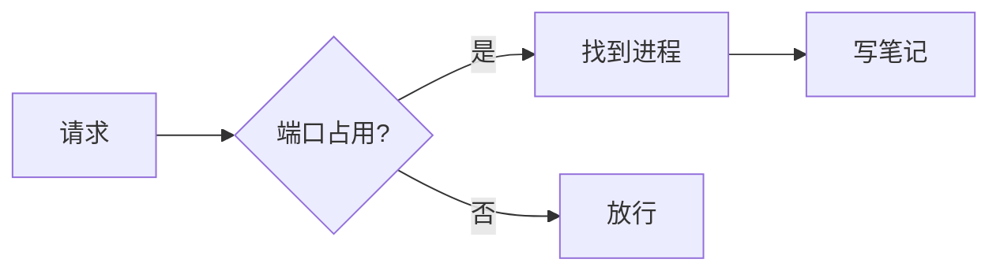
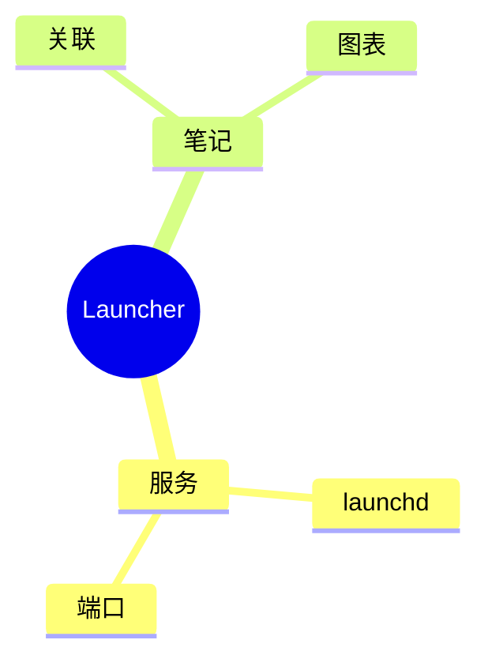
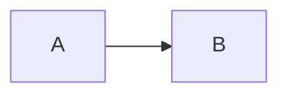

# 随心手记示例

这篇笔记是应用自动生成的，演示了编辑器支持的全部写法。**改它、删它都随意** ——
它只在你笔记目录**完全为空**时创建一次，之后不会再出现。

## 一、基本排版

**粗体**、*斜体*、***粗斜体***、~~删除线~~、`行内代码`，以及 [链接](https://example.com)。
点链接会用**系统浏览器**打开，不在应用里跳。

网址也可以直接写成尖括号：<https://example.com>。**裸写的网址不会自动变链接** ——
免得正文里随手提一句就被认走。

`_斜体_` 与 `__粗体__` 也认，和星号等价（本文一律用星号）。但下划线两边是字母或数字时不算 ——
`foo_bar_baz` 会保持字面，这是为了不把变量名拆成斜体。

反斜杠可以转义：\*这不是斜体\*。

**上下标**：`H~2~O` 渲染成 H~2~O，`x^2^` 渲染成 x^2^。

**段落对齐**：把段落包进 `<div align="center">`（GitHub 与 Obsidian 都认这一种写法）。
工具条上有左 / 中 / 右三个按钮，选中几行点一下就行 —— **左对齐等于「取消对齐」**，
那是 Markdown 的默认：

<div align="center">

这一段是居中的

</div>

<div align="right">

这一段是靠右的

</div>

> 段落对齐在 Markdown 里**没有标准语法**，能可移植的只有 HTML 的 `align`。
> 所以这也是全应用唯一认的一小段 HTML（另一处是表格单元格里的 `<br>`）——
> 别的标签照样按纯文本显示。


> 普通引用就是一行 `>` 开头。它和下面的提示块不是一回事。
>
> 引用里照样能放**块级内容** —— 和提示块一样，正文是按块渲染的：
>
> - 甲
> - 乙
>
> > 嵌套的引用长这样
>
> ```bash
> lsof -i :8080
> ```
>
> | 端口 | 进程 |
> |---|---|
> | 8080 | node |

（**引用与提示块里的表格和正文里的完全一样** —— 拖列宽行高、双击改格子、加行加列都能用。
围栏与重排出来的每一行都会带着 `> ` 前缀，不会跑到引用外面去。图表、图片、嵌入也一样。）

标题六级都认。本文只用到 `#` 与 `##`，下面四行是 `###` 到 `######` 渲染出来的样子：

### 三级标题

#### 四级标题

##### 五级标题

###### 六级标题

---

## 二、提示块（Callout）

写 `> [!类型]`，预览里会变成一张带图标与配色的卡片。五种类型：

> [!NOTE]
> 补充说明。蓝色。

> [!TIP]
> 一个小技巧。绿色。

> [!IMPORTANT] 标题可以自定义
> 标记后面跟的文字就是标题。紫色。

> [!WARNING]
> 需要注意的事。琥珀色。

> [!CAUTION]
> 可能造成损失的操作。红色。

**卡片正文里照样能放块级内容** —— 和普通引用是同一套渲染：

> [!TIP] 正文里可以有列表、代码块、图片
> 排查端口占用的顺序：
>
> 1. 先看谁占着
> 2. 再决定要不要杀
>
> ```bash
> lsof -i :8080
> ```

**在编辑器里敲 `> [` 会弹出这五种让你选**，回车插入骨架。

## 三、折叠块

`<details>` 可以折起来，点标题才展开 —— GitHub 与 Obsidian 都认：

<details>
<summary>点这里展开（里面可以是任何东西）</summary>

折叠块里照常写 Markdown —— 列表、代码块、表格都行：

- 甲
- 乙

```bash
lsof -i :8080
```

| 端口 | 进程 |
|---|---|
| 8080 | node |

</details>

<details open>
<summary>这个默认是展开的</summary>

源码里写 `<details open>` 就会默认展开。

</details>

## 四、列表与任务

- 无序列表
  - 可以嵌套
    - 再深一层
- 混排也行

1. 有序列表
2. 第二项

- [ ] 待办事项
- [x] 已完成的事项

预览里可以直接勾选，⌘Z 能撤销。

## 五、表格

| 端口 | 进程 | 状态 |
|:--|:-:|--:|
| 8080 | node | 占用 |
| 6379 | redis | 空闲 |

列对齐用 `:--`（左）、`:-:`（中）、`--:`（右）。工具条上的表格按钮可以拖选行列直接插入。

**在预览里双击任意一格就能改**，改完整块重排、源码跟着变；表格下方有「加一行 / 加一列」，
每行每列右侧还有删除按钮。

默认边框样式在 **设置 › 笔记 › 表格样式** 里改；单张表可以这样覆盖：

```table border=none
| 无边框 | 靠对齐也能读 |
|---|---|
| 甲 | 乙 |
```

```table border=thick color=#8b5cf6
| 粗边框 | 紫色 |
|---|---|
| 甲 | 乙 |
```

宽度也写在围栏里（不写就铺满一栏）。**拖动表格右下角同样能改宽**，松手把数字写回这里：

```table width=320
| 固定 320 宽 | 第二列 |
|---|---|
| 甲 | 乙 |
```

**单元格里还能放块级内容** —— 一行源文用 `<br>` 当行分隔符就行（竖线要写成 `\|`，
不转义会被当成列分隔符）：

| 类型 | 内容 |
|---|---|
| 列表 | - 甲<br>- 乙 |
| 代码块 | ```bash<br>lsof -i :8080<br>``` |
| 流程图 | ```mermaid<br>flowchart LR<br>A --> B<br>``` |
| 嵌套表格 | \| a \| b \|<br>\|---\|---\|<br>\| 1 \| 2 \| |
| 图片 |  |
| 视频 / 音频 / PDF |  |

只有 `<br>` 换行、没有块级写法时，格子仍然是一段两行 —— `第一行<br>第二行` 不会裂成两个段落。
格子里的任务清单、表格、图表是**只读**的：它们全都来自同一行源文，按行回写会把整条表格行写坏。
格子里的图 / 视频 / PDF / 图表会**跟着格子缩放** —— 把列拖宽，它们就跟着变宽。
**格子里再放一张表格**也一样：外层表的列宽定下来之后（`cols=`），里面那张会跟着格子走；
没定列宽时它按自己的内容收缩（跟着走会形成「表宽依赖格宽、格宽又依赖表宽」的死循环）。

⚠ **里面那张表自己不能再单独拖列宽 / 行高**。原因是**没有地方存**：格子只有一行源文，
而列宽只能写进 ````table 围栏 —— 往一行里插围栏是做不到的。

所以它身上**不会出现任何手柄**，外层表的列边界线也会**在它身上断开**（否则那条线看起来
像小表自己的，拖了改的却是外层）。想调它就调**外层**表的列宽，它会跟着走。

**列宽与行高**也写在围栏里：`cols=200,100,auto`（`auto` = 按内容分）、`rows=80,40`（**最小**高度，
第 1 行是表头）。不写就完全等于从前。

预览里**拖列边界 / 行边界**同样能改，松手把数字写回围栏；点一下没拖动不会回写。
列边界**整条高度都能抓**（不用非回到表头上），行边界**整行宽度都能抓**。

指针移到边线上，光标会变成 **↔**（纵向的列线，左右拖）或 **↕**（横向的行线，上下拖）；
离边线 8px 以内都算命中，不用去瞄那条 1px 的线。拖列边界时整表宽度跟着走，
所以旁边那几列不会被挤动。

### 排版表格：把表格当网格用

加一个 `layout`，它就不再是数据表 —— **不带边框，第一行也不再当表头**（去掉底色/加粗/不换行）。
左图右文这类版式要靠它：GFM 的表格必须有分隔行，内容只能写在第一行，而第一行默认是按表头渲染的。

```table layout cols=120,auto rows=120
|  | **端口排查**<br>先看谁占着 8080，再决定要不要杀。<br>图会跟着这一列一起缩放。 |
|---|---|
```

`layout` 可以和 `cols=` / `rows=` / `width=` 一起写，格子里照样能放列表、代码块、图表、嵌套表格。

## 六、代码

```bash
# 围栏里写上语言名就有语法高亮
lsof -i :8080
```

```json
{ "port": 8080, "name": "node", "pid": 1234 }
```

```yaml
label: homebrew.mxcl.redis
program: /opt/homebrew/bin/redis-server
keepAlive: true
```

常见语言都认：js / ts / json / html / css / xml / plist / yaml / toml / ini / sh / py / sql /
go / rust / dockerfile / diff / nginx …… **鼠标移到代码块右上角有复制按钮。**

围栏也可以用波浪线（`~~~`）。内容里本来就有三个反引号时，这样写不用去数长度：

~~~text
这一段里有 ``` 也不会被提前收尾
~~~

不想换波浪线也行：**用四个反引号包住三个反引号**，闭合按开启时的个数配对 —— 里面那三个不算闭合。

## 七、图片与媒体

图片、视频、音频、PDF 是同一个写法 —— 按后缀自动换控件。
下面这些是**真的能用的例子**（样图随示例笔记一起放进了 `assets/`）。

**① 不写尺寸：铺满一栏**（图片不超过原尺寸，视频/音频/PDF 一律铺满）


**② 写死宽度** `` —— 图片、视频、音频用它（高度按比例）


**③ 写死高度** `` —— PDF 这种「宽度总是铺满」的用它


**④ 视频与音频**（默认铺满，同样可以拖）


**⑤ 拖拽改尺寸 —— 重点试这个**

**用鼠标点一下上面任何一块媒体**，它的右下角会出现一个圆形角柄；
**按住角柄拖**，尺寸实时跟着变，**松手自动把数字写回正文**（左边编辑器里能看到
`` 变成 ``）。

- 图片 / 视频 / 音频拖的是**宽度**，高度按比例跟；
- PDF 与网页嵌入拖的是**高度**（它们的宽度总是铺满）；
- 想改回去：把尺寸删掉即可，或者再拖到原来的大小。

支持的后缀：图片 `png` `jpg` `jpeg` `gif` `webp` `avif` `bmp`；视频 `mp4` `webm` `mov` `m4v` `ogv`；
音频 `mp3` `m4a` `wav` `ogg` `flac` `aac`；文档 `pdf`。

支持的后缀：图片 `png` `jpg` `jpeg` `gif` `webp` `avif` `bmp`；视频 `mp4` `webm` `mov` `m4v` `ogv`；
音频 `mp3` `m4a` `wav` `ogg` `flac` `aac`；文档 `pdf`。

**尺寸**写在方括号里（Obsidian 的写法）：

```markdown
       宽度 300
   宽高都定
          只定高
```

**在预览里点一下媒体，右下角会出现一个角柄，拖它就能改大小** —— 松手自动写回上面的语法。

截图可以直接粘贴或拖进编辑区，会存到笔记目录的 `assets/` 里。**远程图片地址（`https://…`）也会直接显示。**

加载不出来的图片会降级成一个带地址的灰色小条，不会留一个碎图标 ——
B 站 / 知乎这类防盗链的图床很常见，那不是你的写法有问题。

## 八、网页嵌入

本地网页（**不发任何网络请求**）：

```embed
assets/sample-page.html
width: 260
height: 220
```

网址（会让预览**联网去取那个页面**）：

```embed
https://example.com
height: 240
```

地址栏右边的 **↗** 用系统浏览器打开同一个地址。围栏里除了 `height:` 还能写 `width:`，
或者拖右下角改尺寸。远程地址要能显示，得对方允许被 iframe 嵌（很多站点会拒绝，那不是应用的问题）。

## 九、图表





工具条最右的按钮可以插入图表，可视化配方向与主题；鼠标移到图上，右上角能复制源码或重新编辑。
围栏里写 `width=360` 能定宽（不写就按图自身大小、不超过栏宽），也可以拖右下角改。

**语法写错了不会静默消失** —— 那块位置会直接显示 Mermaid 的报错和你的源码，改回去就好。

## 十、场景矩阵：同一个写法，放进不同的盒子

**下面每一格都可以当场试** —— 拖列宽行高、双击改格子、勾任务、拖图 / 图的角柄，
试完看左边源码，**写回的位置对不对一眼就知道**。

八种「盒子」全在这儿：正文、引用、嵌套引用、提示块、折叠块（三种写法）、对齐块。
它们的差别只在**行号怎么算**、**前缀怎么带** —— 所以每格都放同样四样东西：
**表格**（拖列宽行高、双击改格子）、**任务**（勾选）、**图表**（拖宽、编辑）、**图片**（拖角柄）。

（图都缩到 40px、图表只有两个节点 —— 这一节是**验收单**，不是演示，越小越好扫。）

### 1. 正文

| 甲 | 乙 |
|---|---|
| 1 | 2 |

- [ ] 正文里的任务




### 2. 引用

> | 甲 | 乙 |
> |---|---|
> | 1 | 2 |
>
> - [ ] 引用里的任务
>
> ```mermaid
> flowchart LR
>   A --> B
> ```
>
> 
>
### 3. 嵌套引用

> 外面一层
>
> > | 甲 | 乙 |
> > |---|---|
> > | 1 | 2 |
> >
> > - [ ] 嵌套引用里的任务
> >
> > ```mermaid
> > flowchart LR
> >   A --> B
> > ```
> >
> > 
> >
### 4. 提示块

> [!TIP] 卡片里
> | 甲 | 乙 |
> |---|---|
> | 1 | 2 |
>
> - [ ] 提示块里的任务
>
> ```mermaid
> flowchart LR
>   A --> B
> ```
>
> 
>
### 5. 折叠块（两行写法）

<details open>
<summary>点开</summary>

| 甲 | 乙 |
|---|---|
| 1 | 2 |

- [ ] 折叠块（两行）里的任务


</details>

### 6. 折叠块（一行写法）

<details open><summary>点开</summary>

| 甲 | 乙 |
|---|---|
| 1 | 2 |

- [ ] 折叠块（一行）里的任务


</details>

### 7. 折叠块（不写 summary）

<details open>

| 甲 | 乙 |
|---|---|
| 1 | 2 |

- [ ] 折叠块（无 summary）里的任务


</details>

### 8. 对齐块

<div align="center">

| 甲 | 乙 |
|---|---|
| 1 | 2 |

- [ ] 对齐块里的任务


</div>

## 十一、编辑区是源码模式

左边是**源码**，右边是**成品**。编辑区只做两件事：**上色**（标记压暗、语法着色）和
**字形**（加粗显示为粗体、斜体显示为斜体）。标题不会变大、代码块没有整块底色 ——
所以每一行严格等高，读起来就是一份可以改的源码。

分栏时两边**联动滚动**，靠的是「这一块在源文里是第几行」。元数据行上的 🔗 可以关掉它。

顶部那三个按钮是**分栏 / 只编辑 / 只预览**；只预览时底部工具条会收起来。

## 十二、笔记本身

正文之外，这篇笔记自己还能挂东西，都在顶上的元数据行：

- **关联服务** —— 点「+ 关联服务」，把它挂到某个 Agent / 定时任务 / 端口服务上。关联是**双向**的：
  服务卡片上会出现「相关笔记」，服务改名或重启之后这边照样指得对。
- **标签** —— 元数据行的输入框里回车就加一条，存在 frontmatter 里；左侧搜索框能按标签搜。
- **搜索** —— 左侧搜索框同时搜标题、正文与标签。

文件就是普通的 `.md`，用 Obsidian / iCloud / git 直接改也行 —— 应用发现外部改动会自动重新载入；
那时如果你还有没保存的修改，会问你要留哪一份，不会静默覆盖。

## 十三、快捷键

| 快捷键 | 作用 |
|---|---|
| `⌘B` | 加粗 |
| `⌘I` | 斜体 |
| `⌘K` | 链接 |
| `⌘Z` / `⇧⌘Z` | 撤销 / 重做 |
| `> [` | 弹出提示块类型 |

---

*这篇笔记随时可以删掉。*
